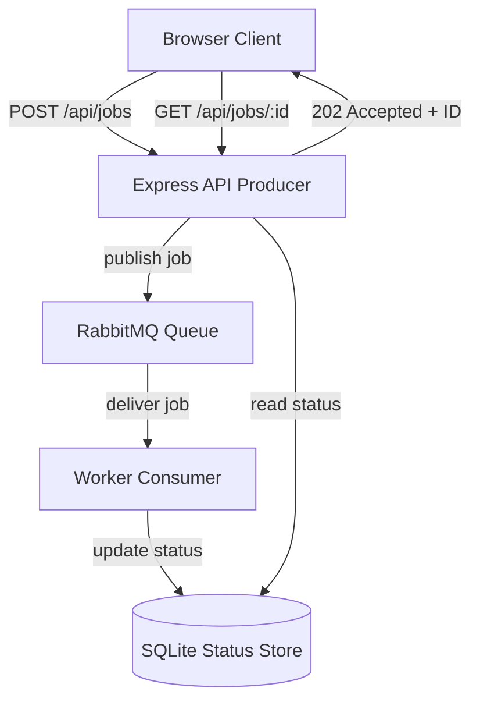

# Asynchronous Integration: REST API & Message Queue Decoupling

> **Current stage:** Step 2 audit completed. The queue uses durable topology, persistent messages, manual ACK/NACK handling, a DLQ, and basic consumer idempotency.

## Initial Architecture



## Initial Files

- `api/server.js` — REST producer and status endpoint.
- `worker/worker.js` — background report processor.
- `shared/` — RabbitMQ connection and SQLite job status functions.
- `public/index.html` — simple submit-and-poll dashboard.
- `docker-compose.yml` — RabbitMQ plus management dashboard.
- `ai_prompt_log.md` — the exact initial prompt and later audit results.

## Step 2 Corrections

- Main queue and dead-letter queue are durable.
- Published jobs are persistent.
- The worker uses manual acknowledgments and ACKs only after it records completion.
- A malformed payload is NACKed without requeueing and routed to `report_jobs_dlq`.
- A redelivered job already marked `completed` is ACKed and skipped.

## Run Guide

```bash
docker compose down -v
docker compose up -d
npm install
npm run start:api
```

Open a second terminal in the same folder:

```bash
npm run start:worker
```

Then visit `http://localhost:3000`. RabbitMQ Management is at `http://localhost:15672` with username `guest` and password `guest`.
